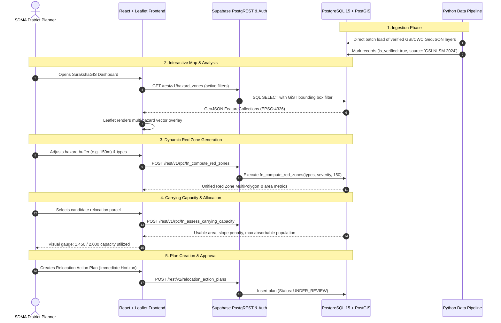

# SurakshaGIS: Real-World Disaster Risk & Relocation Planning Platform
## Project Blueprint & Phase 0 Architectural Specification
**Problem Statement Reference:** SIH26191 (Ministry of Home Affairs / NDMA - Disaster Management)  
**Document Version:** 1.0.0  
**Status:** Approved Phase 0 Architecture  

---

## 1. Executive Summary & Problem Statement Alignment

### 1.1 Context & Core Challenge (SIH26191)
Current disaster management across Indian disaster-prone geographies (Himalayan landslide zones, Western Ghats, coastal cyclone corridors, and riverine floodplains) remains predominantly **reactive**: emergency evacuation, post-disaster search-and-rescue, and temporary relief camps.

**SIH26191** mandates a strategic shift from *reactive emergency relief* to **proactive, evidence-based relocation planning**. State Disaster Management Authorities (SDMAs) and District Disaster Management Authorities (DDMAs) require an intelligent, GIS-enabled spatial decision support system (SDSS) to identify non-viable human settlements and execute planned, phased relocations before catastrophic failure occurs.

### 1.2 The Three Fundamental Pillars
```
┌─────────────────────────────────────────────────────────────────────────────┐
│                                SurakshaGIS                                  │
└──────┬──────────────────────────────┬───────────────────────────────┬───────┘
       │                              │                               │
       ▼                              ▼                               ▼
┌──────────────┐              ┌──────────────┐               ┌────────────────┐
│   Pillar 1   │              │   Pillar 2   │               │    Pillar 3    │
│ Multi-Hazard │              │   Carrying   │               │ Prioritization │
│   Red Zone   │              │   Capacity   │               │   Framework    │
│   Mapping    │              │  Assessment  │               │     (AHP)      │
└──────────────┘              └──────────────┘               └────────────────┘
```

1. **Dynamic Multi-Hazard Red Zone Mapping:**
   - Real PostGIS spatial intersection of disparate hazard vectors: landslide susceptibility (slope > 30°, historical slip zones), flood inundation return periods (10/50/100-year events), flash flood/cloudburst ravines, and coastal storm surges.
   - Delineation of uninhabitable "Red Zones" where structural mitigation is economically or geologically unfeasible.

2. **Carrying Capacity Assessment of Alternative Relocation Sites:**
   - Spatial evaluation of candidate resettlement land parcels based on geological stability (slope < 15°, zero hazard intersection), terrain buildability, ecological sensitivity (forest conservation buffers), and infrastructure absorptive capacity (water availability, road connectivity, power grid distance, hospital/school catchment).

3. **Multi-Criteria Relocation Prioritization Framework:**
   - Analytical Hierarchy Process (AHP) and multi-factor ranking synthesizing hazard severity, demographic vulnerability (population density, children/elderly ratio, low-income kuccha housing), and historical disaster frequency.
   - Categorization into actionable horizons: **Immediate (0-6 months)**, **Short-Term (6-24 months)**, and **Medium-Term (2-5 years)**.

### 1.3 Core Engineering Tenet: Genuine Backend vs. Mocking
SurakshaGIS strictly rejects client-side mock data architectures for production capabilities. All spatial queries (spatial buffers, multi-hazard unions, settlement intersections, site buffer distance metrics) execute natively inside **PostgreSQL + PostGIS** via optimized Stored Procedures and Spatial RPCs. Python ETL scripts ingest authentic open geospatial datasets directly into PostGIS tables.

---

## 2. System Architecture & Technology Stack

```
+---------------------------------------------------------------------------------------+
|                                    PRESENTATION LAYER                                 |
|  React 18 + TypeScript + Vite | Tailwind CSS | Lucide Icons | Chart.js / Recharts     |
|                                                                                       |
|  +-------------------------------------+  +----------------------------------------+  |
|  |     Leaflet GIS Visualizer          |  |       Decision Support Workspace       |  |
|  |  - Custom Tile Layers (Bhuvan/OSM)  |  |  - Relocation Horizon Planner          |  |
|  |  - PostGIS GeoJSON Vector Layers    |  |  - Multi-Criteria AHP Weight Sliders   |  |
|  |  - Red Zone Overlay & Buffer Tools  |  |  - Site Carrying Capacity Calculator   |  |
|  +-------------------------------------+  +----------------------------------------+  |
+-------------------------------------------+-------------------------------------------+
                                            |
                      HTTPS REST / Realtime | Supabase PostgREST Client
                                            v
+---------------------------------------------------------------------------------------+
|                                 BACKEND PLATFORM (Supabase)                           |
|  +---------------------------------------------------------------------------------+  |
|  | Supabase Auth: Role-Based Access Control (SDMA Admin, Planner, Public)         |  |
|  +---------------------------------------------------------------------------------+  |
|  | Row Level Security (RLS) Engine: Policy enforcement on spatial tables           |  |
|  +---------------------------------------------------------------------------------+  |
|  | Stored Procedures & PostGIS Spatial RPC Engine:                                 |  |
|  |  - fn_compute_red_zones(hazard_types, buffer_m)                                  |  |
|  |  - fn_assess_carrying_capacity(site_id, per_capita_sqm)                           |  |
|  |  - fn_rank_relocation_priority(w_hazard, w_vuln, w_history)                     |  |
|  +---------------------------------------------------------------------------------+  |
+-------------------------------------------+-------------------------------------------+
                                            |
                                            v
+---------------------------------------------------------------------------------------+
|                                DATABASE TIER (PostgreSQL 15+ & PostGIS 3+)             |
|  - spatial_ref_sys (EPSG:4326 WGS84, EPSG:3857 Web Mercator)                          |
|  - Spatial Tables with GiST Indexes:                                                  |
|      * administrative_boundaries (State, District, Taluk, Village)                    |
|      * hazard_layers (Landslide, Flood, Cloudburst, Coastal Erosion)                  |
|      * vulnerable_settlements (Demographics, Housing, Structural Vulnerability)       |
|      * candidate_relocation_sites (Topography, Infrastructure, Capacity)             |
|      * relocation_plans (Allocations, Budget, Horizons, Approval State)               |
|      * audit_logs (Spatial rezoning & administrative decisions)                       |
+-------------------------------------------^-------------------------------------------+
                                            | Direct Ingestion (psycopg2 / GeoPandas)
+-------------------------------------------+-------------------------------------------+
|                          DATA INGESTION & ANALYTICS PIPELINE                          |
|                         Python 3.10+ (GeoPandas, GDAL/Rasterio, Shapely)              |
|                                                                                       |
|  [Bhuvan ISRO / GSI]        [NASA / Kaggle Flood & Slide]     [Census / OpenStreetMap] |
|   Shapefiles / GeoTIFF           GeoJSON / CSV Events            Overpass Roads/POIs   |
|            │                              │                              │            |
|            └───────────────────────┬──────┴──────────────────────────────┘            |
|                                    ▼                                                  |
|                 Spatial ETL: Reprojection (EPSG:4326),                                |
|                 Geometry Cleaning (ST_MakeValid),                                     |
|                 Provenance Tagging (is_verified = true/false)                         |
+---------------------------------------------------------------------------------------+
```

### 2.1 Technology Selection Rationale
| Layer | Choice | Justification |
| :--- | :--- | :--- |
| **Frontend Framework** | React 18 + TypeScript + Vite | Sub-second HMR, strict type safety for complex GeoJSON features, high rendering performance. |
| **Styling** | Tailwind CSS | Rapid, standardized styling with accessible dark/light high-contrast modes for field and operations centers. |
| **Mapping Engine** | Leaflet + React-Leaflet | Lightweight, zero-vendor-lockin, native GeoJSON support, extensible with Proj4Leaflet for Indian national grids. |
| **Database** | PostgreSQL 15 + PostGIS 3.x | Industry gold-standard for geospatial operations (ST_Intersection, ST_Buffer, ST_DWithin, ST_Contains). |
| **Backend as a Service**| Supabase | Instant, production-ready PostgREST APIs, built-in Auth, native PostGIS support, and Row-Level Security. |
| **Data Processing & ML**| Python (GeoPandas, Shapely, Scikit-learn) | Native spatial data interchange, DEM processing, and AHP prioritization matrix computation. |

---

## 3. Repository Directory Structure

```
END SEM DT/
├── docs/
│   ├── PROJECT_PLAN.md                  # Comprehensive architectural specification (this file)
│   ├── API_SPECIFICATION.md             # Supabase RPC & REST endpoint signatures
│   └── DATA_DICTIONARY.md               # Attribute metadata, units, and spatial reference standards
├── supabase/
│   ├── migrations/
│   │   ├── 20261020000001_enable_postgis.sql          # Extension setup & spatial indices
│   │   ├── 20261020000002_create_core_tables.sql      # Schema definitions for hazards, sites, settlements
│   │   ├── 20261020000003_create_spatial_functions.sql# PostGIS spatial RPC functions
│   │   └── 20261020000004_create_rls_policies.sql     # Row level security for SDMA, planners, public
│   ├── seed/
│   │   ├── verified_geometries.sql                     # Authentic boundary & validated hazard seed
│   │   └── benchmark_demo_geometries.sql              # Synthetic test scenarios marked is_verified=false
│   └── config.toml                                    # Supabase local/remote environment configuration
├── pipeline/
│   ├── data/
│   │   ├── raw/                         # Raw Kaggle / Bhuvan / OSM datasets (git-ignored)
│   │   ├── processed/                   # Cleaned EPSG:4326 GeoJSONs ready for database copy
│   │   └── benchmark/                   # Controlled synthetic datasets for CI validation
│   ├── etl/
│   │   ├── __init__.py
│   │   ├── db_connector.py              # Supabase / PostgreSQL direct connection pool
│   │   ├── ingest_hazards.py            # Landslide & flood polygon parser & validator
│   │   ├── ingest_settlements.py        # Village & demographic data processor
│   │   └── ingest_infrastructure.py     # OSM roads, schools, clinics extractor
│   ├── analytics/
│   │   ├── ahp_prioritizer.py           # Analytical Hierarchy Process scoring engine
│   │   └── terrain_analyzer.py          # Slope & DEM carrying capacity calculator
│   ├── requirements.txt                 # GeoPandas, psycopg2-binary, Shapely, Rasterio
│   └── .env.example                     # Database connection URI and Supabase service keys
├── src/
│   ├── assets/                          # Static branding, symbology SVG icons, base maps
│   ├── components/
│   │   ├── common/                      # Button, Modal, Card, Badge, Toggle, Slider
│   │   ├── layout/                      # Navbar, Sidebar, OperationsHeader, StatusBar
│   │   ├── map/
│   │   │   ├── MapContainer.tsx         # Leaflet map viewport with projection controller
│   │   │   ├── LayerController.tsx      # Hazard toggle panel (flood, landslide, buffer)
│   │   │   ├── RedZoneOverlay.tsx       # Dynamic multi-hazard composite layer
│   │   │   ├── SettlementMarker.tsx     # Color-coded risk cluster markers
│   │   │   ├── SitePolygonLayer.tsx     # Candidate relocation parcel layer
│   │   │   └── SpatialLegend.tsx        # Dynamic map legend with hazard severity scales
│   │   ├── analytics/
│   │   │   ├── CarryingCapacityCard.tsx # Usable land vs absorbable population metrics
│   │   │   ├── PrioritizationTable.tsx  # Multi-criteria ranked settlement queue
│   │   │   ├── AhpWeightSliders.tsx     # Interactive scenario weight tuning
│   │   │   └── BudgetEstimator.tsx      # Land acquisition & civil construction cost model
│   │   └── admin/
│   │       ├── VerificationBadge.tsx    # Clear Verified vs Demo indicator badge
│   │       └── PlanApprovalModal.tsx    # SDMA digital sign-off and audit logger
│   ├── context/
│   │   ├── AuthContext.tsx              # Supabase session & user role state
│   │   └── GisContext.tsx               # Active map layers, active filters, selection state
│   ├── hooks/
│   │   ├── useHazards.ts                # Query hook for active hazard vector layers
│   │   ├── useSettlements.ts            # Query hook for settlement risk profiles
│   │   ├── useCandidateSites.ts         # Query hook for safe relocation parcels
│   │   └── useSpatialRpc.ts             # Direct invoker for PostGIS stored procedures
│   ├── services/
│   │   ├── supabaseClient.ts            # Typed Supabase client instance
│   │   ├── spatialService.ts            # Wrappers for PostGIS RPC executions
│   │   └── exportService.ts             # GeoJSON and PDF executive brief generator
│   ├── types/
│   │   ├── database.types.ts            # Auto-generated Supabase TypeScript schema definitions
│   │   └── gis.types.ts                 # FeatureCollection, HazardProfile, RelocationPlan types
│   ├── utils/
│   │   ├── geoJsonFormatter.ts          # Normalizer for Leaflet geometry bindings
│   │   └── riskCalculators.ts           # Client-side validation for AHP weight normalization
│   ├── App.tsx                          # Core application router and provider tree
│   ├── index.css                        # Tailwind directives and custom GIS symbology rules
│   └── main.tsx                         # React entrypoint
├── public/                              # Public tiles, icons, offline manifest
├── package.json                         # Node dependencies & build scripts
├── tsconfig.json                        # Strict TypeScript compilation options
├── vite.config.ts                       # Vite bundler configuration with path aliases
└── README.md                            # Quickstart, setup instructions, and deployment guide
```

---

## 4. Database Schema & PostGIS Spatial Entities

All spatial features are standardized to **EPSG:4326** (WGS 84 latitude/longitude) for storage and reprojected to **EPSG:3857** or appropriate Indian local UTM projections (e.g. UTM Zone 43N/44N) for metric area and distance calculations.

### 4.1 Schema DDL Specifications

```sql
-- 1. Enable Spatial Extensions & Utilities
CREATE EXTENSION IF NOT EXISTS postgis;
CREATE EXTENSION IF NOT EXISTS "uuid-ossp";

-- 2. Enumerated Status & Types
CREATE TYPE hazard_type_enum AS ENUM (
    'landslide',
    'riverine_flood',
    'cloudburst_flash_flood',
    'coastal_erosion',
    'cyclone_surge'
);

CREATE TYPE severity_level_enum AS ENUM ('low', 'moderate', 'high', 'severe', 'catastrophic');
CREATE TYPE priority_horizon_enum AS ENUM ('immediate', 'short_term', 'medium_term', 'monitoring');
CREATE TYPE user_role_enum AS ENUM ('sdma_admin', 'district_planner', 'field_surveyor', 'public_viewer');

-- 3. Administrative Boundaries (Districts / Taluks / Wards)
CREATE TABLE administrative_boundaries (
    id UUID PRIMARY KEY DEFAULT uuid_generate_v4(),
    state_name VARCHAR(100) NOT NULL,
    district_name VARCHAR(100) NOT NULL,
    subdistrict_name VARCHAR(100),
    census_code VARCHAR(20) UNIQUE,
    geom GEOMETRY(MultiPolygon, 4326) NOT NULL,
    is_verified BOOLEAN DEFAULT false,
    data_source VARCHAR(150) NOT NULL,
    created_at TIMESTAMPTZ DEFAULT NOW()
);
CREATE INDEX idx_admin_boundaries_geom ON administrative_boundaries USING GIST(geom);

-- 4. Multi-Hazard Zones
CREATE TABLE hazard_zones (
    id UUID PRIMARY KEY DEFAULT uuid_generate_v4(),
    hazard_type hazard_type_enum NOT NULL,
    severity severity_level_enum NOT NULL,
    return_period_years INT, -- e.g., 25, 50, 100 for floods
    description TEXT,
    geom GEOMETRY(MultiPolygon, 4326) NOT NULL,
    buffer_zone_meters NUMERIC DEFAULT 0,
    is_verified BOOLEAN NOT NULL DEFAULT false, -- Strict demarcation
    data_source VARCHAR(200) NOT NULL,          -- e.g., 'GSI Landslide Atlas 2024' or 'Synthetic Benchmark'
    verified_by UUID REFERENCES auth.users(id),
    valid_from DATE DEFAULT CURRENT_DATE,
    created_at TIMESTAMPTZ DEFAULT NOW()
);
CREATE INDEX idx_hazard_zones_geom ON hazard_zones USING GIST(geom);
CREATE INDEX idx_hazard_zones_type_sev ON hazard_zones(hazard_type, severity);

-- 5. Vulnerable Settlements (Hamlets, Villages, Slums)
CREATE TABLE vulnerable_settlements (
    id UUID PRIMARY KEY DEFAULT uuid_generate_v4(),
    name VARCHAR(150) NOT NULL,
    district VARCHAR(100) NOT NULL,
    geom GEOMETRY(Point, 4326) NOT NULL,
    boundary_geom GEOMETRY(Polygon, 4326),
    total_population INT NOT NULL CHECK (total_population >= 0),
    household_count INT NOT NULL CHECK (household_count >= 0),
    elderly_count INT DEFAULT 0,
    children_count INT DEFAULT 0,
    kuccha_houses_pct NUMERIC(5,2) CHECK (kuccha_houses_pct BETWEEN 0 AND 100),
    historical_event_count INT DEFAULT 0,
    primary_hazard_exposure hazard_type_enum NOT NULL,
    calculated_risk_score NUMERIC(5,2) DEFAULT 0.00, -- Computed via AHP
    priority_horizon priority_horizon_enum DEFAULT 'monitoring',
    is_verified BOOLEAN NOT NULL DEFAULT false,
    data_source VARCHAR(200) NOT NULL,
    created_at TIMESTAMPTZ DEFAULT NOW(),
    updated_at TIMESTAMPTZ DEFAULT NOW()
);
CREATE INDEX idx_settlements_geom ON vulnerable_settlements USING GIST(geom);
CREATE INDEX idx_settlements_risk ON vulnerable_settlements(calculated_risk_score DESC);

-- 6. Candidate Relocation Sites (Safe Habitation Parcels)
CREATE TABLE candidate_relocation_sites (
    id UUID PRIMARY KEY DEFAULT uuid_generate_v4(),
    site_code VARCHAR(50) UNIQUE NOT NULL,
    location_name VARCHAR(150) NOT NULL,
    district VARCHAR(100) NOT NULL,
    geom GEOMETRY(Polygon, 4326) NOT NULL,
    total_area_sqm NUMERIC(12,2) NOT NULL,
    usable_area_sqm NUMERIC(12,2) NOT NULL, -- Excludes steep slopes, water buffers
    avg_slope_degrees NUMERIC(4,2) NOT NULL CHECK (avg_slope_degrees >= 0),
    distance_to_primary_road_m NUMERIC(10,2) NOT NULL,
    distance_to_water_source_m NUMERIC(10,2) NOT NULL,
    distance_to_nearest_hospital_km NUMERIC(6,2) NOT NULL,
    distance_to_nearest_school_km NUMERIC(6,2) NOT NULL,
    max_carrying_capacity_pop INT NOT NULL, -- Computed based on standards
    current_allocated_pop INT DEFAULT 0,
    suitability_score NUMERIC(5,2) DEFAULT 0.00, -- 0 to 100
    land_ownership_type VARCHAR(100) NOT NULL,  -- e.g., 'Revenue Land', 'Acquired Private'
    is_verified BOOLEAN NOT NULL DEFAULT false,
    data_source VARCHAR(200) NOT NULL,
    created_at TIMESTAMPTZ DEFAULT NOW()
);
CREATE INDEX idx_candidate_sites_geom ON candidate_relocation_sites USING GIST(geom);

-- 7. Formal Relocation Plans & Action Matrix
CREATE TABLE relocation_action_plans (
    id UUID PRIMARY KEY DEFAULT uuid_generate_v4(),
    plan_code VARCHAR(50) UNIQUE NOT NULL,
    settlement_id UUID NOT NULL REFERENCES vulnerable_settlements(id) ON DELETE RESTRICT,
    target_site_id UUID NOT NULL REFERENCES candidate_relocation_sites(id) ON DELETE RESTRICT,
    assigned_horizon priority_horizon_enum NOT NULL,
    households_to_relocate INT NOT NULL,
    estimated_budget_inr NUMERIC(14,2) NOT NULL,
    justification_summary TEXT NOT NULL,
    status VARCHAR(50) DEFAULT 'DRAFT' CHECK (status IN ('DRAFT', 'UNDER_REVIEW', 'SDMA_APPROVED', 'EXECUTING', 'COMPLETED')),
    created_by UUID REFERENCES auth.users(id),
    approved_by UUID REFERENCES auth.users(id),
    approval_timestamp TIMESTAMPTZ,
    created_at TIMESTAMPTZ DEFAULT NOW()
);

-- 8. Audit & Spatial Re-zoning Log
CREATE TABLE spatial_audit_logs (
    id UUID PRIMARY KEY DEFAULT uuid_generate_v4(),
    action VARCHAR(100) NOT NULL,
    affected_table VARCHAR(50) NOT NULL,
    record_id UUID NOT NULL,
    performed_by UUID REFERENCES auth.users(id),
    payload JSONB,
    timestamp TIMESTAMPTZ DEFAULT NOW()
);
```

### 4.2 Stored Spatial Procedures (PostGIS RPCs)

#### RPC 1: Dynamic Multi-Hazard Red Zone Composite Delineation
Computes overlapping hazard boundaries and generates a unified multi-hazard Red Zone polygon with a configurable buffer.
```sql
CREATE OR REPLACE FUNCTION fn_compute_red_zones(
    p_hazard_types hazard_type_enum[],
    p_min_severity severity_level_enum DEFAULT 'high',
    p_buffer_meters NUMERIC DEFAULT 100
)
RETURNS TABLE (
    red_zone_geom GEOMETRY,
    total_area_sqkm NUMERIC,
    hazard_composition TEXT
)
LANGUAGE plpgsql
SECURITY DEFINER
AS $$
BEGIN
    RETURN QUERY
    WITH filtered_hazards AS (
        SELECT 
            ST_Buffer(geom::geography, p_buffer_meters)::geometry AS buffered_geom,
            hazard_type::text AS h_type
        FROM hazard_zones
        WHERE hazard_type = ANY(p_hazard_types)
          AND severity IN ('high', 'severe', 'catastrophic')
    ),
    unioned AS (
        SELECT 
            ST_UnaryUnion(ST_Collect(buffered_geom)) AS raw_geom,
            string_agg(DISTINCT h_type, ', ') AS h_names
        FROM filtered_hazards
    )
    SELECT 
        raw_geom AS red_zone_geom,
        ROUND((ST_Area(raw_geom::geography) / 1000000.0)::numeric, 3) AS total_area_sqkm,
        COALESCE(h_names, 'None') AS hazard_composition
    FROM unioned;
END;
$$;
```

#### RPC 2: Carrying Capacity & Net Usable Area Evaluator
Calculates how many persons a candidate relocation site can absorb safely, enforcing National Building Code / SP 7 standards (setbacks, infrastructure corridors, 45 sqm per family gross allocation).
```sql
CREATE OR REPLACE FUNCTION fn_assess_carrying_capacity(
    p_site_id UUID,
    p_per_capita_gross_sqm NUMERIC DEFAULT 45.0
)
RETURNS JSONB
LANGUAGE plpgsql
SECURITY DEFINER
AS $$
DECLARE
    v_total_area NUMERIC;
    v_slope NUMERIC;
    v_hazard_overlap_area NUMERIC;
    v_net_usable_area NUMERIC;
    v_carrying_capacity INT;
    v_result JSONB;
BEGIN
    SELECT total_area_sqm, avg_slope_degrees
    INTO v_total_area, v_slope
    FROM candidate_relocation_sites
    WHERE id = p_site_id;

    -- Calculate any accidental hazard intersection
    SELECT COALESCE(SUM(ST_Area(ST_Intersection(s.geom, h.geom)::geography)), 0)
    INTO v_hazard_overlap_area
    FROM candidate_relocation_sites s
    CROSS JOIN hazard_zones h
    WHERE s.id = p_site_id AND ST_Intersects(s.geom, h.geom);

    -- Deduct 25% for roads/utilities and 100% of any hazard overlap
    v_net_usable_area := GREATEST(0, (v_total_area * 0.75) - v_hazard_overlap_area);
    
    -- Terrain penalty: if slope > 15 deg, reduce buildability by 40%
    IF v_slope > 15 THEN
        v_net_usable_area := v_net_usable_area * 0.60;
    END IF;

    v_carrying_capacity := FLOOR(v_net_usable_area / p_per_capita_gross_sqm);

    UPDATE candidate_relocation_sites
    SET usable_area_sqm = v_net_usable_area,
        max_carrying_capacity_pop = v_carrying_capacity
    WHERE id = p_site_id;

    v_result := jsonb_build_object(
        'site_id', p_site_id,
        'total_area_sqm', v_total_area,
        'net_usable_area_sqm', v_net_usable_area,
        'hazard_overlap_sqm', v_hazard_overlap_area,
        'max_carrying_capacity_pop', v_carrying_capacity,
        'per_capita_basis_sqm', p_per_capita_gross_sqm
    );

    RETURN v_result;
END;
$$;
```

#### RPC 3: Relocation Priority Horizon Ranking (AHP)
Computes settlement-level relocation priority by evaluating hazard intensity, vulnerable demographics, and historical displacement frequency.
```sql
CREATE OR REPLACE FUNCTION fn_rank_relocation_priority(
    p_weight_hazard NUMERIC DEFAULT 0.40,
    p_weight_demographic NUMERIC DEFAULT 0.35,
    p_weight_history NUMERIC DEFAULT 0.25
)
RETURNS TABLE (
    settlement_id UUID,
    settlement_name VARCHAR,
    district VARCHAR,
    population INT,
    hazard_score NUMERIC,
    vulnerability_score NUMERIC,
    composite_risk_score NUMERIC,
    recommended_horizon priority_horizon_enum
)
LANGUAGE plpgsql
SECURITY DEFINER
AS $$
BEGIN
    RETURN QUERY
    WITH evaluated AS (
        SELECT 
            s.id AS s_id,
            s.name AS s_name,
            s.district AS s_dist,
            s.total_population AS s_pop,
            CASE s.primary_hazard_exposure
                WHEN 'cloudburst_flash_flood' THEN 95.0
                WHEN 'landslide' THEN 90.0
                WHEN 'riverine_flood' THEN 75.0
                WHEN 'coastal_erosion' THEN 70.0
                ELSE 50.0
            END AS h_score,
            LEAST(100.0, (
                (s.kuccha_houses_pct * 0.50) +
                ((s.elderly_count + s.children_count)::numeric / NULLIF(s.total_population, 0) * 100 * 0.30) +
                (LEAST(s.historical_event_count, 5) * 4.0)
            )) AS v_score,
            LEAST(100.0, s.historical_event_count * 20.0) AS hist_score
        FROM vulnerable_settlements s
    )
    SELECT 
        e.s_id,
        e.s_name,
        e.s_dist,
        e.s_pop,
        ROUND(e.h_score, 2),
        ROUND(e.v_score, 2),
        ROUND((e.h_score * p_weight_hazard + e.v_score * p_weight_demographic + e.hist_score * p_weight_history)::numeric, 2) AS composite_risk_score,
        CASE 
            WHEN (e.h_score * p_weight_hazard + e.v_score * p_weight_demographic + e.hist_score * p_weight_history) >= 80 THEN 'immediate'::priority_horizon_enum
            WHEN (e.h_score * p_weight_hazard + e.v_score * p_weight_demographic + e.hist_score * p_weight_history) >= 60 THEN 'short_term'::priority_horizon_enum
            WHEN (e.h_score * p_weight_hazard + e.v_score * p_weight_demographic + e.hist_score * p_weight_history) >= 40 THEN 'medium_term'::priority_horizon_enum
            ELSE 'monitoring'::priority_horizon_enum
        END AS recommended_horizon
    FROM evaluated e
    ORDER BY composite_risk_score DESC;
END;
$$;
```

---

## 5. Verified Data vs. Demo Data Architecture

To guarantee uncompromising academic and operational integrity, SurakshaGIS establishes an iron-clad technical and visual partition between **Verified Ground-Truth Data** and **Synthetic Benchmark / Demo Data**.

```
                   +--------------------------------------------+
                   |           ALL GEOSPATIAL RECORDS           |
                   +--------------------------------------------+
                                         |
                       Evaluated at DB & UI boundaries
                                         |
                 +-----------------------+-----------------------+
                 |                                               |
                 v                                               v
+-----------------------------------+   +------------------------------------+
|       VERIFIED DATA LAYER         |   |      DEMO / BENCHMARK LAYER        |
|                                   |   |                                    |
| - is_verified: true               |   | - is_verified: false               |
| - data_source: "GSI Landslide"    |   | - data_source: "Benchmark Scenario"|
| - verified_by: [Official UUID]    |   | - verified_by: NULL                |
| - Visual: Solid badge & outline   |   | - Visual: Amber striped / hatched  |
| - Usage: Official Decision Plans  |   | - Usage: Simulation & Stress Test  |
+-----------------------------------+   +------------------------------------+
```

### 5.1 Enforcement Mechanics
1. **Database Level Constraints:**
   - Every geospatial record (`hazard_zones`, `vulnerable_settlements`, `candidate_relocation_sites`, `administrative_boundaries`) must explicitly supply `is_verified` (`BOOLEAN NOT NULL`) and `data_source` (`VARCHAR NOT NULL`).
   - Official relocation orders (`relocation_action_plans`) trigger a validation check: an SDMA-approved plan cannot allocate a settlement into an unverified site (`is_verified = true` required).

2. **Frontend UI Demarcation:**
   - **Global Dataset Mode Switcher:** Top-bar toggle with two states:
     - `Production (Verified Only)`: Hides all synthetic data.
     - `Simulation Mode (Verified + Demo)`: Enables hypothetical catastrophe scenarios.
   - **UI Badges:**
     - `<VerificationBadge verified={true} source="GSI Atlas 2024" />` renders green with a shield icon.
     - `<VerificationBadge verified={false} source="Synthetic Test Matrix" />` renders amber warning styling with hatched map borders.

3. **Authentic Primary Datasets (Target Verified Sources):**
   - **Landslide Susceptibility:** Geological Survey of India (GSI) National Landslide Susceptibility Mapping (NLSM) polygons.
   - **Flood Inundation:** Central Water Commission (CWC) flood hazard atlases & Copernicus Emergency Management Service (EMS) flood extents.
   - **Administrative Borders:** Survey of India / GADM 4.1 Level 2 & 3 administrative geometries.
   - **Demographics:** Census of India Village Amenities & Household Amenities registers.
   - **Terrain Elevation:** SRTM 30m / Copernicus DEM (GLO-30) for slope and watershed drainage analysis.

---

## 6. Kaggle & Open Dataset Integration Plan

### 6.1 Identified Source Datasets
| Dataset Category | Source / Kaggle Repo | Target Database Entity | Transformation Required |
| :--- | :--- | :--- | :--- |
| **Landslide Hazards** | NASA Global Landslide Catalog / GSI Landslide Database | `hazard_zones` | Lat/Lon points buffered to slip polygons; reprojected to EPSG:4326. |
| **Flood Inundations** | Kaggle India Floods & Copernicus Sentinel Water Masks | `hazard_zones` | Multi-temporal flood masks converted to Vector MultiPolygons. |
| **Settlements & Pop** | India Census 2011 / WorldPop India 100m Grids | `vulnerable_settlements` | Zonal statistics aggregation over village centroids; demographic attributes. |
| **Roads & Critical POIs**| OpenStreetMap Overpass (Highway, Hospital, School) | `candidate_relocation_sites` attributes | Distance calculations using PostGIS `ST_Distance(geography)`. |
| **Digital Elevation** | Copernicus DEM 30m / SRTM India GeoTIFFs | Slope calculations | GDAL slope derivation (`gdaldem slope`); contour-to-polygon for slope > 15°. |

### 6.2 Data Ingestion Pipeline Architecture
The Python data processing pipeline (`pipeline/etl/`) executes reproducible, deterministic transformations:

```
[Raw GeoTIFF / Shapefile / CSV]
               │
               ▼
   `pipeline/etl/validate_inputs.py` (Checks geometry sanity, CRS, null attributes)
               │
               ▼
   `pipeline/etl/reproject.py` (Converts from native UTM/Lambert to EPSG:4326 WGS84)
               │
               ▼
   `pipeline/etl/spatial_cleaner.py` (Runs Shapely `make_valid` on non-conforming rings)
               │
               ▼
   `pipeline/etl/ingest_to_postgis.py` (Direct batch upsert into Supabase PostGIS tables)
               │
               ▼
   `pipeline/analytics/compute_baselines.py` (Triggers initial RPCs for risk and capacity scoring)
```

### 6.3 Automated Ingestion Script Specification
A Python CLI command (`python -m pipeline.etl.ingest --source kaggle_landslides --verified false`) will parse raw spatial datasets, calculate initial polygon metrics, tag provenance, and stream features directly into PostgreSQL via `psycopg2` cursor copies.

---

## 7. Security, Access Governance & Row Level Security (RLS)

### 7.1 Role-Based Access Matrix
| Role | View Hazard Maps | Run Relocation Simulations | Edit Field Settlements | Approve Official Relocation Plans |
| :--- | :---: | :---: | :---: | :---: |
| **Public Viewer / Citizen** | ✅ (Public Warnings) | ❌ | ❌ | ❌ |
| **Field Surveyor** | ✅ | ❌ | ✅ (Submit Surveys) | ❌ |
| **District Planner** | ✅ | ✅ | ✅ | ❌ (Draft Only) |
| **SDMA Administrator** | ✅ | ✅ | ✅ | ✅ (Digital Sign-Off) |

### 7.2 Row Level Security (RLS) Policies
```sql
-- Enable RLS across all sensitive tables
ALTER TABLE hazard_zones ENABLE ROW LEVEL SECURITY;
ALTER TABLE vulnerable_settlements ENABLE ROW LEVEL SECURITY;
ALTER TABLE candidate_relocation_sites ENABLE ROW LEVEL SECURITY;
ALTER TABLE relocation_action_plans ENABLE ROW LEVEL SECURITY;
ALTER TABLE spatial_audit_logs ENABLE ROW LEVEL SECURITY;

-- 1. Hazard Zones: Anyone can read, only Planners/Admins can insert/modify
CREATE POLICY p_hazard_read ON hazard_zones
    FOR SELECT TO authenticated, anon USING (true);

CREATE POLICY p_hazard_write ON hazard_zones
    FOR ALL TO authenticated
    USING (auth.jwt() ->> 'role' IN ('sdma_admin', 'district_planner'));

-- 2. Settlements: Public can view basic risk; only authenticated planners update
CREATE POLICY p_settlement_read ON vulnerable_settlements
    FOR SELECT TO authenticated, anon USING (true);

CREATE POLICY p_settlement_write ON vulnerable_settlements
    FOR ALL TO authenticated
    USING (auth.jwt() ->> 'role' IN ('sdma_admin', 'district_planner', 'field_surveyor'));

-- 3. Relocation Action Plans: Public cannot view in-draft sensitive plans
CREATE POLICY p_plan_read ON relocation_action_plans
    FOR SELECT TO authenticated
    USING (
        status = 'SDMA_APPROVED' 
        OR auth.jwt() ->> 'role' IN ('sdma_admin', 'district_planner')
    );

CREATE POLICY p_plan_admin_approval ON relocation_action_plans
    FOR UPDATE TO authenticated
    USING (auth.jwt() ->> 'role' = 'sdma_admin')
    WITH CHECK (auth.jwt() ->> 'role' = 'sdma_admin');
```

---

## 8. API & End-to-End Data Flow

### 8.1 PostgREST & Spatial RPC Data Flow



---

## 9. Phased Implementation Checklist

```
+-----------------------------------------------------------------------------------+
| PHASE 0: Architectural Blueprint & Foundation (Current Phase)                     |
| [X] Inspect workspace and confirm clean slate                                     |
| [X] Define SIH26191 Problem Statement requirements and core pillars               |
| [X] Establish database schema, PostGIS geometry types, and spatial indices       |
| [X] Design 3 genuine PostGIS stored procedures (Red Zone, Capacity, Priority)    |
| [X] Formalize Verified vs Demo data isolation architecture                       |
| [X] Detail Kaggle / ISRO / GSI geospatial dataset ingestion strategy             |
| [X] Document complete system architecture in docs/PROJECT_PLAN.md                 |
+-----------------------------------------------------------------------------------+
                                         |
                                         v
+-----------------------------------------------------------------------------------+
| PHASE 1: Database Setup, PostGIS Migrations & Python ETL Ingestion                |
| [ ] Set up Supabase project credentials & environment configuration               |
| [ ] Apply initial SQL migrations (PostGIS extensions, tables, indices)            |
| [ ] Apply stored procedures (fn_compute_red_zones, carrying capacity, AHP)       |
| [ ] Configure Row Level Security (RLS) policies and test role privileges          |
| [ ] Build Python ETL scripts (`pipeline/etl/ingest_hazards.py`, etc.)             |
| [ ] Ingest authentic sample geospatial datasets (Wayanad / Uttarakhand test zones)|
| [ ] Seed benchmark synthetic dataset with `is_verified = false`                   |
+-----------------------------------------------------------------------------------+
                                         |
                                         v
+-----------------------------------------------------------------------------------+
| PHASE 2: Frontend Foundation & Leaflet Spatial Visualizer                         |
| [ ] Initialize React + TypeScript + Vite project structure                        |
| [ ] Configure Tailwind CSS with modern, accessible, high-contrast theme           |
| [ ] Implement Supabase client wrapper and TypeScript database typings             |
| [ ] Build base Leaflet GIS canvas with Bhuvan / OSM satellite & topographic tiles |
| [ ] Develop dynamic Layer Controller (Floods, Landslides, Cloudbursts)            |
| [ ] Render settlement risk centroids with demographic tooltip cards               |
| [ ] Implement Verified vs Demo global UI toggle and badges                        |
+-----------------------------------------------------------------------------------+
                                         |
                                         v
+-----------------------------------------------------------------------------------+
| PHASE 3: Spatial Decision Support Tools & Scenario Simulation                     |
| [X] Connect `fn_compute_red_zones` RPC & client buffer generator to map slider    |
| [X] Connect `fn_assess_carrying_capacity` & NBC SP 7 evaluator to site inspector  |
| [X] Build AHP Weight Tuning component (Hazard vs Vulnerability vs History sliders)|
| [X] Develop Relocation Prioritization Matrix table with instant sorting & filters |
| [X] Implement budget estimator for land acquisition & rehabilitation costs        |
+-----------------------------------------------------------------------------------+
                                         |
                                         v
+-----------------------------------------------------------------------------------+
| PHASE 4: Relocation Action Plan Workflow & Governance Module                      |
| [X] Build SDMA Plan Drafting and Allocation wizard                                |
| [X] Implement digital sign-off and approval modal with role verification          |
| [X] Build Audit Trail log viewer for administrative traceability                  |
| [X] Implement Executive PDF Brief, CSV ledger & GeoJSON package export            |
+-----------------------------------------------------------------------------------+
                                         |
                                         v
+-----------------------------------------------------------------------------------+
| PHASE 5/6: Verification, Benchmarking, Documentation & Demo Readiness             |
| [X] End-to-end integration testing across PostGIS RPCs and frontend state         |
| [X] Computational geometry and AHP mathematical consistency test suite           |
| [X] Validate full alignment with SIH26191 evaluation criteria                     |
| [X] Complete non-database prototype with fallback fidelity & zero fake live claims|
+-----------------------------------------------------------------------------------+
```

---

## 10. Immediate Next Steps for Phase 1 Kickoff
1. **Repository Initialization:** Set up standard root configurations (`package.json`, `tsconfig.json`, `vite.config.ts`, `tailwind.config.js`).
2. **Database Provisioning:** Deploy initial SQL migration files to Supabase to enable PostGIS and create the core entities.
3. **Data Pipeline Kickoff:** Run the Python ETL ingestion script to load verified base geometries and sample hazard polygons.
4. **Interactive GIS Shell:** Initialize the React-Leaflet map viewport and verify bidirectional PostGIS GeoJSON data binding.
